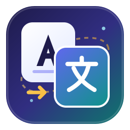

<div align="center">



# Paradox AI Translator

**Your world, Your word!**

A workshop-aware translation workbench for five Paradox games that keeps variables, colours and formatting intact, and reuses a translation only when the English source hash still matches.

[English](README.md) · [Documentation (综合说明)](introduction.md) · [Tutorials (新手教程)](tutorials/)

<sub>Missing your language? [Add it!](https://github.com/sdloghub/paradox-ai-translator/issues/new)</sub>

</div>

---

## What it does

Pick a subscribed Workshop Mod, let the tool find the English localisation, translate it with your own API key, and write the Chinese back into the Mod (or export it as a separate translation Mod). It is not a prompt wrapper: most of the work is deciding what is safe to reuse, what must keep its raw formatting, and what has to stay English when something is wrong.

- **Five games**: Stellaris, Hearts of Iron IV, Europa Universalis IV, Crusader Kings III, Victoria 3.
- **Hash-matched cache**: a translation is reused only when the Mod, entry key and English SHA-256 still match. Old text never silently overwrites a changed source.
- **Format protection**: `$variables$`, `[scripted_loc]`, §-colour codes, icons, escape sequences and duplicate keys are validated. A failing entry keeps its English line and gets a file + line number in the report.
- **Local first**: Mods are read from your own Steam library. Config, SQLite cache and backups stay on your machine.
- **Web version**: visitors translate a Workshop link without an account, in an isolated workspace, with a one-off API key that is never persisted.

## Quick start

### Web

Open **https://paradox-ai-translator.com/** , paste a Workshop link, scan, fill in your API details for this task, translate, then download the result. There is no sign-up. The site keeps no API key — see the [deployment notes](introduction.md#3-服务器端-web-版本-部署与运维指南) for what the server does and does not store.

### Desktop (macOS)

- **Release package**: Download WorkshopTranslator-macOS-arm64.zip from [Releases](https://github.com/sdloghub/paradox-ai-translator/releases), unzip, double-click WorkshopTranslator.app. Apple Silicon, no separate Python install. The build is not Developer-ID signed, so allow it once in *System Settings → Privacy & Security*.
- **From source**: Double-click setup_mac.command (or run ./setup_mac.command in terminal).

### Desktop (Windows)

- **Release package**: Download and unzip the release archive, then run WorkshopTranslator.exe (Windows 10/11 x64). Keep the _internal folder next to the executable. Data lives in %LOCALAPPDATA%\WorkshopTranslator\app_data.
- **From source**: Double-click start_windows.bat (or run start_windows.bat in command prompt).

### From source (Cross-platform CLI)

`sh
python3 -m venv .venv
.venv/bin/python -m pip install -r requirements.txt
.venv/bin/python workshop_app.py
`

Offline demo, no paid API calls: python workshop_app.py --demo (or start_windows.bat --demo).

## How a translation runs

```text
ACF manifest  →  scan Mod  →  extract English + existing Chinese
                              ↓
                     hash-matched cache  →  translate only what is missing
                              ↓
                     format validation  →  write back / export
```

1. **Refresh** reads `appworkshop_<AppID>.acf` for the installed item list instead of walking every game directory.
2. **Scan Mod** extracts English entries and their hashes, plus any Chinese already present in the Mod.
3. **Translate** sends only untranslated or stale entries; each batch keeps protected placeholders.
4. **Review** the entry browser: filter by translated / cached / untranslated / needs update / format error, edit individual lines or translations, with backups before anything is overwritten.
5. **Export** a standalone translation Mod, or just write the Chinese back into the original.

## Safety rules that are not optional

| Situation | Behaviour |
| --- | --- |
| English source changed | Old translation marked *needs update*, not reused |
| Variables or formatting broken | Entry keeps English, logged with file and line |
| Duplicate key in a file | Flagged as a format error, no API call made |
| Source file edited elsewhere | Write refused instead of overwriting |
| Translation failed | Kept out of the success cache so it can be retried |

## Workshop-aware caching

The cache is keyed by Mod, entry key and English SHA-256 inside SQLite. A manual edit creates a new version and keeps the old Chinese and its source in `translation_edits`; the new row is tagged as a manual revision. Deleting a cached version removes only that version's rows and mapping — other versions, shared entries and the Chinese already inside the original Mod stay.

Every destructive action backs up first, then removes. The *clear translation files* button restores English for EU4 rather than deleting blindly.

## Generating a translation Mod

The generated Mod is placed in `Documents/Paradox Interactive/<Game>/mod/` as `workshop_translation_<AppID>_<UID>.mod` plus a folder of the same name, holding `descriptor.mod`, `localisation/`, the description, a ZIP, a source list and a usage note. The original Mod's cover image is copied as `thumbnail.*`.

Only entries whose English hash matches and whose formatting validates are exported. The `remote_file_id` is never invented: a first upload gets its ID from Steam, and regeneration of an already published patch only keeps an ID that is present and consistent. Publishing to the Workshop from the tool is not enabled — use the game launcher.

## Sharing and credit

A finished translation can be shared voluntarily. Credit is optional and empty means anonymous; the model shown is the one that actually completed the task, not a value from the submission form. Publishing permission to the Workshop is a separate, unchecked, default-off opt-in. Sharing does not equal publishing permission, and permission does not mean this run may publish.

## Testing

```sh
python3 -m unittest discover -s tests -v
```

Tests use fake providers; no real API is called. Release builds run the same suite plus `--self-test` before artifacts are uploaded.

## Documentation

| Document | Contents |
| --- | --- |
| [introduction.md](introduction.md) | Comprehensive documentation: macOS, Windows, and Server deployment |
| [tutorials/beginner_tutorial.md](tutorials/beginner_tutorial.md) | Step-by-step beginner walkthrough |
| [tutorials/](tutorials/) | Tutorials and guides directory |
| setup_mac.command | One-click startup script for macOS |
| start_windows.bat | One-click startup script for Windows |

The interface and user documentation are organized in [introduction.md](introduction.md) and [tutorials/](tutorials/).

## Repo layout

```text
workshop_app.py        service, tasks, HTTP API, APP_VERSION
workshop_ui.html       shared workbench UI
server_*.py            web version: sessions, workshop download, upload
paradox.py request.py  translation core and model requests
rules.json             prompts and formatting rules
translation_cache.py   SQLite cache, entry index
mod_export.py          patch, cover and export
tests/ packaging/      offline regression tests, build scripts
```

## Notes

The Mac and Windows builds are unsigned; verify the checksum file shipped with each release.

---

<div align="center">
<sub>Your world, Your word! · <a href="https://github.com/sdloghub/paradox-ai-translator/issues/new">Missing your language? Add it!</a></sub>
</div>
