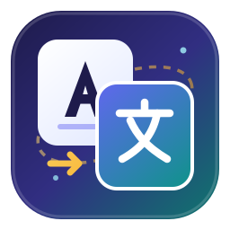

<div align="center">



# Paradox AI Translator

**Your world, Your word!**

面向五款 Paradox 游戏的创意工坊汉化工作台：保留变量、颜色与格式标记，只在英文哈希仍然匹配时复用旧译文。

[English](README.md) · [简体中文](README.zh-CN.md) · [繁體中文](README.zh-TW.md)

<sub>Missing your language? [Add it!](https://github.com/sdloghub/paradox-ai-translator/issues/new)</sub>

</div>

---

## 它做什么

选中已订阅的创意工坊 Mod，自动找出英文原文，用你自己的 API Key 翻译，再把中文回写进原 Mod，或导出成独立的翻译 Mod。这不是把提示词包一层界面：真正的工作量在于判断哪些译文可以安全复用、哪些必须原样保留格式、哪些在出错时应该保留英文。

- **五款游戏**：群星、钢铁雄心4、欧陆风云4、十字军之王3、维多利亚3。
- **哈希匹配缓存**：只有 Mod、条目键与英文 SHA-256 全部一致才复用译文，旧译文不会静默覆盖已变的原文。
- **格式保护**：`$变量$`、`[scripted_loc]`、§ 颜色码、图标、转义符和重复键均会校验；失败条目保留英文，并在报告中给出文件与行号。
- **本地优先**：Mod 从你自己的 Steam 库读取，配置、SQLite 缓存与备份都留在本机。
- **网页版**：访客无需注册即可翻译工坊链接，使用独立工作区与仅本次任务有效的一次性 Key。

## 快速开始

### 网页版

打开 **https://paradox-ai-translator.com/** ，粘贴工坊链接，扫描，填写本次任务的 API 信息，翻译后下载结果。没有注册入口。网站不保存 API Key，服务器具体存什么、不存什么见[服务器部署说明.md](服务器部署说明.md)。

### 桌面版（macOS）

从 [Releases](https://github.com/sdloghub/paradox-ai-translator/releases) 下载 `WorkshopTranslator-macOS-arm64.zip`，解压后双击 `WorkshopTranslator.app`。适用于 Apple Silicon，无需另装 Python。该版本未做 Developer ID 签名，首次打开需在“系统设置 → 隐私与安全性”中允许一次。

### 桌面版（Windows）

下载并完整解压发布包，运行 `WorkshopTranslator.exe`（Windows 10/11 x64），保留同目录的 `_internal` 文件夹。数据位于 `%LOCALAPPDATA%\WorkshopTranslator\app_data`。

### 从源码运行

```sh
python3 -m venv .venv
.venv/bin/python -m pip install -r requirements.txt
.venv/bin/python workshop_app.py
```

离线演示，不调用付费接口：`.venv/bin/python workshop_app.py --demo`。

## 一次翻译的流程

```text
ACF 清单  →  扫描 Mod  →  提取英文与已有中文
                        ↓
                哈希匹配缓存  →  只翻译缺失部分
                        ↓
                格式校验  →  回写 / 导出
```

1. **刷新目录** 读取 `appworkshop_<AppID>.acf` 获取已安装清单，不遍历整个游戏目录。
2. **扫描此 Mod** 提取英文条目及其哈希，同时读取 Mod 中已有的中文。
3. **翻译** 只发送未翻译或已过期的条目，每批都保留受保护占位符。
4. **检查** 条目浏览库可按已翻译 / 已缓存 / 未翻译 / 需更新 / 格式错误筛选，可改原文件行或中文译文，覆盖前先备份。
5. **导出** 生成独立翻译 Mod，或只把中文回写进原 Mod。

## 不能省略的安全规则

| 情况 | 行为 |
| --- | --- |
| 英文原文已变 | 旧译文标为「需更新」，不再复用 |
| 变量或格式损坏 | 该条保留英文，日志记录文件与行号 |
| 文件内重复键 | 标为格式错误，不发起 API 请求 |
| 原文件被外部修改 | 拒绝覆盖，而不是照写 |
| 翻译失败 | 不写入成功缓存，可继续重试 |

## 创意工坊感知的缓存

缓存以 Mod、条目键与英文 SHA-256 为键保存在 SQLite 中。手动修改会创建新版本，旧中文及其来源保留在 `translation_edits`，新行标记为手动修订。删除某个缓存版本只移除该版本的记录与映射，其他版本、共享缓存以及原 Mod 内已有的中文都不受影响。

所有破坏性操作都先备份再删除；「清除翻译文件」在欧陆风云 4 中恢复英文原文，而不是直接删除。

## 生成翻译 Mod

生成结果位于 `Documents/Paradox Interactive/<游戏>/mod/`，为 `workshop_translation_<AppID>_<UID>.mod` 及同名文件夹，内含 `descriptor.mod`、`localisation/`、简介、ZIP、来源清单与使用说明；原 Mod 封面会复制为 `thumbnail.*`。

只导出英文哈希匹配且格式校验通过的条目。`remote_file_id` 不会自行编造：首次发布由 Steam 分配，重新生成已发布补丁时只保留已存在且一致的 ID。工具内的工坊投稿入口尚未启用，请在游戏启动器中发布。

## 共享与署名

完成的翻译可以选择共享。署名留空即为匿名，展示的模型来自真正完成该任务的模型，而不是提交表单里的声明。授权开发者发布到创意工坊是单独的可选项，默认不勾选；共享不等于发布授权，获得授权也不等于本次任务已获准发布。

## 测试

```sh
python3 -m unittest discover -s tests -v
```

测试使用模拟接口，不会调用真实 API。发布构建在上传产物前会再跑一次同一套测试与 `--self-test`。

## 文档

| 文档 | 内容 |
| --- | --- |
| [新手教程.md](新手教程.md) | 第一次使用的分步教程 |
| [Mac使用说明.md](Mac使用说明.md) | macOS 发布包与重新构建 |
| [Windows使用说明.md](Windows使用说明.md) | Windows 发布包与重新构建 |
| [服务器部署说明.md](服务器部署说明.md) | 自行部署网页版 |

界面与使用文档目前为中文；README 提供英文、简体中文和繁体中文版本，入口见页面顶部。

## 目录结构

```text
workshop_app.py        服务、任务、HTTP 接口与 APP_VERSION
workshop_ui.html       共用工作台界面
server_*.py            网页版：访客会话、工坊下载、上传提取
paradox.py request.py  翻译处理与模型请求
rules.json             提示词与格式规则
translation_cache.py   SQLite 缓存与条目索引
mod_export.py          补丁、封面与导出
tests/ packaging/      离线回归测试与构建脚本
```

## 备注

Mac 与 Windows 构建未签名，请核对每次发布附带的校验文件。

---

<div align="center">
<sub>Your world, Your word! · <a href="https://github.com/sdloghub/paradox-ai-translator/issues/new">Missing your language? Add it!</a></sub>
</div>
