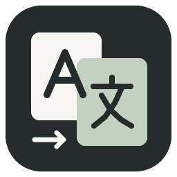

<div align="center">



# Paradox AI Translator

**Your world, Your word**

面向五款 Paradox 遊戲的工作坊翻譯工作台：保留變數、顏色與格式標記，只在英文雜湊仍然相符時沿用舊譯文。

[English](README.md) · [简体中文](README.zh-CN.md) · [繁體中文](README.zh-TW.md)

<sub>Missing your language? [Add it!](https://github.com/sdloghub/paradox-ai-translator/issues/new)</sub>

</div>

---

## 它做什麼

選取已訂閱的工作坊 Mod，自動找出英文原文，用你自己的 API Key 翻譯，再把中文寫回原 Mod，或匯出成獨立的翻譯 Mod。這不是把提示詞包一層介面：真正的工作量在於判斷哪些譯文可以安全沿用、哪些必須原樣保留格式、哪些在出錯時應該保留英文。

- **五款遊戲**：群星、鋼鐵雄心4、歐陸風雲4、十字軍之王3、維多利亞3。
- **雜湊比對快取**：只有 Mod、條目鍵與英文 SHA-256 全部相符才沿用譯文，舊譯文不會靜默覆蓋已變的原文。
- **格式保護**：`$變數$`、`[scripted_loc]`、§ 顏色碼、圖示、跳脫字元與重複鍵均會驗證；失敗條目保留英文，並在報告中給出檔案與行號。
- **本機優先**：Mod 從你自己的 Steam 收藏庫讀取，設定、SQLite 快取與備份都留在本機。
- **網頁版**：訪客無需註冊即可翻譯工作坊連結，使用獨立工作區與僅本次任務有效的一次性 Key。

## 快速開始

### 網頁版

開啟 **https://paradox-ai-translator.com/** ，貼上工作坊連結，掃描，填寫本次任務的 API 資訊，翻譯後下載結果。沒有註冊入口。網站不保存 API Key，伺服器具體存什麼、不存什麼見[服务器部署说明.md](服务器部署说明.md)。

### 桌面版（macOS）

從 [Releases](https://github.com/sdloghub/paradox-ai-translator/releases) 下載 `WorkshopTranslator-macOS-arm64.zip`，解壓後雙擊 `WorkshopTranslator.app`。適用於 Apple Silicon，無需另裝 Python。此版本未做 Developer ID 簽署，首次開啟需在「系統設定 → 隱私權與安全性」中允許一次。

### 桌面版（Windows）

下載並完整解壓發行包，執行 `WorkshopTranslator.exe`（Windows 10/11 x64），保留同目錄的 `_internal` 資料夾。資料位於 `%LOCALAPPDATA%\WorkshopTranslator\app_data`。

### 從原始碼執行

```sh
python3 -m venv .venv
.venv/bin/python -m pip install -r requirements.txt
.venv/bin/python workshop_app.py
```

離線示範，不呼叫付費介面：`.venv/bin/python workshop_app.py --demo`。

## 一次翻譯的流程

```text
ACF 清單  →  掃描 Mod  →  擷取英文與既有中文
                        ↓
                雜湊比對快取  →  只翻譯缺少部分
                        ↓
                格式驗證  →  寫回 / 匯出
```

1. **重新整理目錄** 讀取 `appworkshop_<AppID>.acf` 取得已安裝清單，不遍歷整個遊戲目錄。
2. **掃描此 Mod** 擷取英文條目及其雜湊，同時讀取 Mod 中既有的中文。
3. **翻譯** 只送出未翻譯或已過期的條目，每批都保留受保護的佔位符。
4. **檢查** 條目瀏覽庫可按已翻譯 / 已快取 / 未翻譯 / 需更新 / 格式錯誤篩選，可改原檔案行或中文譯文，覆寫前先備份。
5. **匯出** 產生獨立翻譯 Mod，或只把中文寫回原 Mod。

## 不能省略的安全規則

| 情況 | 行為 |
| --- | --- |
| 英文原文已變 | 舊譯文標為「需更新」，不再沿用 |
| 變數或格式損壞 | 該條保留英文，日誌記錄檔案與行號 |
| 檔案內重複鍵 | 標為格式錯誤，不發起 API 請求 |
| 原檔案被外部修改 | 拒絕覆寫，而不是照寫 |
| 翻譯失敗 | 不寫入成功快取，可繼續重試 |

## 工作坊感知的快取

快取以 Mod、條目鍵與英文 SHA-256 為鍵儲存在 SQLite 中。手動修改會建立新版本，舊中文及其來源保留在 `translation_edits`，新資料列標記為手動修訂。刪除某個快取版本只移除該版本的記錄與對應，其他版本、共用快取以及原 Mod 內既有的中文都不受影響。

所有破壞性操作都先備份再刪除；「清除翻譯檔案」在歐陸風雲 4 中還原英文原文，而不是直接刪除。

## 產生翻譯 Mod

產生結果位於 `Documents/Paradox Interactive/<遊戲>/mod/`，為 `workshop_translation_<AppID>_<UID>.mod` 及同名資料夾，內含 `descriptor.mod`、`localisation/`、簡介、ZIP、來源清單與使用說明；原 Mod 封面會複製為 `thumbnail.*`。

只匯出英文雜湊相符且格式驗證通過的條目。`remote_file_id` 不會自行編造：首次發佈由 Steam 指派，重新產生已發佈補丁時只保留已存在且一致的 ID。工具內的工作坊投稿入口尚未啟用，請在遊戲啟動器中發佈。

## 共用與署名

完成的翻譯可以選擇共用。署名留空即為匿名，顯示的模型來自真正完成該任務的模型，而不是提交表單裡的宣告。授權開發者發佈到工作坊是另外的可選項，預設不勾選；共用不等於發佈授權，取得授權也不等於本次任務已獲准發佈。

## 測試

```sh
python3 -m unittest discover -s tests -v
```

測試使用模擬介面，不會呼叫真實 API。發行建置在上傳產物前會再跑一次同一套測試與 `--self-test`。

## 文件

| 文件 | 內容 |
| --- | --- |
| [新手教程.md](新手教程.md) | 第一次使用的分步教學 |
| [Mac使用说明.md](Mac使用说明.md) | macOS 發行包與重新建置 |
| [Windows使用说明.md](Windows使用说明.md) | Windows 發行包與重新建置 |
| [服务器部署说明.md](服务器部署说明.md) | 自行部署網頁版 |

介面與使用文件目前為中文；README 提供英文、簡體中文與繁體中文版本，入口見頁面頂部。

## 目錄結構

```text
workshop_app.py        服務、任務、HTTP 介面與 APP_VERSION
workshop_ui.html       共用工作台介面
server_*.py            網頁版：訪客工作階段、工作坊下載、上傳擷取
paradox.py request.py  翻譯處理與模型請求
rules.json             提示詞與格式規則
translation_cache.py   SQLite 快取與條目索引
mod_export.py          補丁、封面與匯出
tests/ packaging/      離線回歸測試與建置腳本
```

## 備註

- `localisation/`、`chn/`、`already/`、日誌、資料庫與 API Key 均只保存在本機，已被 Git 忽略。
- Mac 與 Windows 建置未簽署，請核對每次發行附帶的校驗檔案。
- GitHub Pages 無法執行 Python 後端，網頁版需要真實伺服器。

如果金鑰曾被提交到原始碼，請到服務商主控台撤銷並重新建立：僅從原始碼刪除既不會使舊金鑰失效，也不會清除 Git 歷史。

---

<div align="center">
<sub>Your world, Your word · <a href="https://github.com/sdloghub/paradox-ai-translator/issues/new">Missing your language? Add it!</a></sub>
</div>
